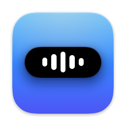

# Transcript Island

Dictation for the Mac that lives in the Dynamic Island.

Press a shortcut, talk, and your words land in whatever text field you were typing in, or on
the clipboard if there isn't one. While you talk, a black bar grows out of the island (or notch)
and shows your words as live captions, with a waveform that follows your voice.

Speech-to-text runs entirely on your Mac, using Apple's `SpeechAnalyzer`.

## Using it

Transcript Island is a menu bar app (the waveform icon).

- **⌥⇧Space** starts dictating. A soft chime plays and the island opens. You can change the
  shortcut from the menu bar icon.
- **Pause for about 2 seconds** and it finishes on its own. **Esc** finishes right away.
  ("Finish when I pause" can be turned off in the menu; Esc is only captured while dictating.)
- The text is pasted into the app you started in, wherever its cursor is. It's always copied
  to the clipboard as well, so if no text field was focused you can paste it yourself with ⌘V.
- When it's done, the island says where the text went: "Pasted into Notes",
  "Copied · ⌘V to paste", "Copied · Accessibility is off", or "Nothing heard".

### Permissions

- **Microphone**: asked for the first time you dictate.
- **Accessibility** (System Settings › Privacy & Security › Accessibility): needed to send the
  paste keystroke (⌘V) to other apps. Without it, the text is only copied to the clipboard.
  If macOS doesn't prompt, add the app with the **+** button and allow it.

macOS 27 shows an indicator in the island ("System & App Protection Override in use") for
about a minute whenever an app reads another app's interface through the Accessibility API.
Transcript Island never does that: it only sends the ⌘V keystroke, which doesn't trigger the
indicator. The cost is that it can't tell whether a text field was focused.

## Requirements

- macOS 27 or later, on a Mac that supports on-device speech recognition
- Xcode 27.2 or later to build

On a Mac with a Dynamic Island or a notch, the bar grows out of it. Without one, it drops from
the top of the screen.

## Install

```bash
./Scripts/install.sh
```

This builds the Release configuration, installs it as `/Applications/Transcript Island.app`
and launches it. To develop, open `TranscriptIsland.xcodeproj` and run the `TranscriptIsland`
scheme. Quit the installed copy first, since both would claim the same shortcut.

### Signing

With no team set, builds are signed to run locally. That works, but macOS ties the
Accessibility permission to the exact build, so every rebuild silently revokes it (System
Settings may still show it as allowed).

To keep permissions across rebuilds, sign with your Apple Development team: create
`Config/Signing.local.xcconfig` (git-ignored) containing

```
DEVELOPMENT_TEAM = ABCDE12345
```

## Project layout

| Path | What it is |
| --- | --- |
| `TranscriptIsland/` | The app. `AppModel` runs the flow: shortcut (`HotKey`) → microphone and `SpeechAnalyzer` (`DictationSession`, `AudioSources`) → the island (`IslandPanel`) → pasting or copying the text (`TextDelivery`). |
| `Packages/TranscriptCore/` | Logic that needs no microphone or screen, with unit tests: `CaptionLines` (wraps the transcript into caption lines that roll up), `PauseDetector` (decides when you've stopped talking), `TranscriptCondenser` (accumulates the recognizer's results). |
| `Config/` | Entitlements and signing settings. |
| `Scripts/` | `install.sh`, and `make-icon.swift`, which draws the app icon. |

### How the island works

- It's a borderless, non-activating panel just above the menu bar. It never becomes key and
  ignores clicks, so focus stays in the app you're dictating into.
- The bar springs out of the island's own shape and shrinks back into it (`IslandShape`, from
  the area macOS reports around the notch). The notch hides anything drawn behind it, so the
  captions start just below it; the band beside it holds the Esc hint and a timer.
- `CaptionLines` decides the line breaks by measuring text, so a word never jumps between
  lines: new words fade in at the end of the bottom line, and full lines roll up.
- The waveform follows the microphone level.
- `PauseDetector` counts new words from the recognizer, or a level clearly above the room's
  noise floor, as speech. About 2 s of silence after speech ends the dictation; 8 s if nothing
  is said.

### Tests and debug helpers

```bash
cd Packages/TranscriptCore && swift test
```

Debug builds accept flags for trying the app without a microphone:

```bash
APP="<build folder>/Transcript Island.app"

# Play a fake dictation in the island, then quit:
open -n "$APP" --args --island-demo

# A full dictation from a recording, played at real speed and followed by silence, so the
# pause detector ends it. Writes a report instead of pasting:
say -o /tmp/sample.aiff "Testing, one two three"
open -n "$APP" --args --dictate-file /tmp/sample.aiff /tmp/report.txt

# The same, but really pasting into one process (this replaces the clipboard):
open -n "$APP" --args --dictate-file /tmp/sample.aiff /tmp/report.txt --paste-into-pid 12345

# Just the speech pipeline: writes the model name and the transcript.
"$APP/Contents/MacOS/Transcript Island" --transcribe-file /tmp/sample.aiff /tmp/out.txt
```

The app logs under its bundle ID:

```bash
log stream --predicate 'subsystem == "com.example.TranscriptIsland.mac"'
```

### The icon

```bash
swift Scripts/make-icon.swift TranscriptIsland/Assets.xcassets/AppIcon.appiconset
```

## Before distributing

- The bundle ID is a placeholder (`com.example.TranscriptIsland.mac`). Changing it means
  granting the permissions again.
- The app isn't sandboxed, because pasting into other apps uses a synthesized ⌘V. It would
  need notarizing to run on other Macs.
